# Capturas de la app real · Fase 3

Demo local en macOS, datos y archivos sintéticos; ningún registro de producción. Los errores de cuota, caducidad, conexión y almacenamiento son inyecciones controladas de la demo.

Las capturas son anteriores al ajuste final de transparencia del recuadro, progreso listo/pausado y texto de archivo truncado. El cierre nativo y las métricas de rendimiento no están comprobados.

## Asignaciones · ficha técnica

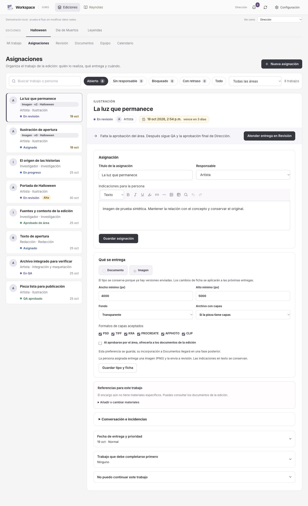

## Mi trabajo · entradas a la entrega

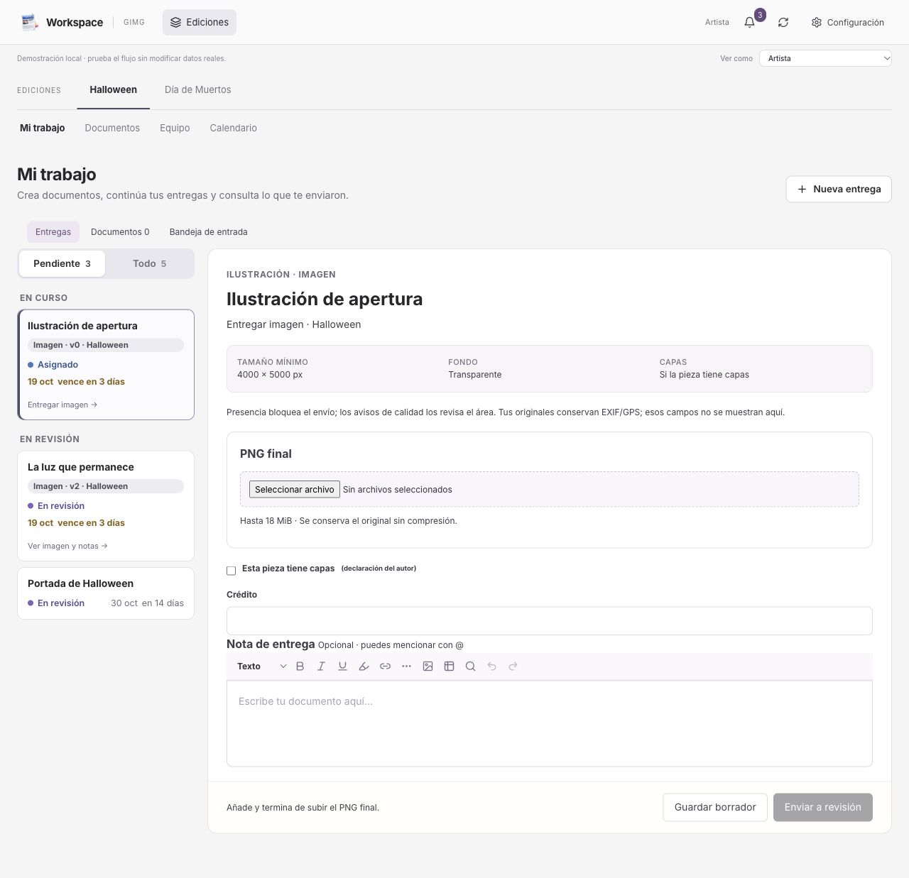

## Entrega de PNG

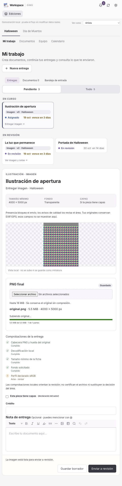

## Revisión · marcas y lista de notas

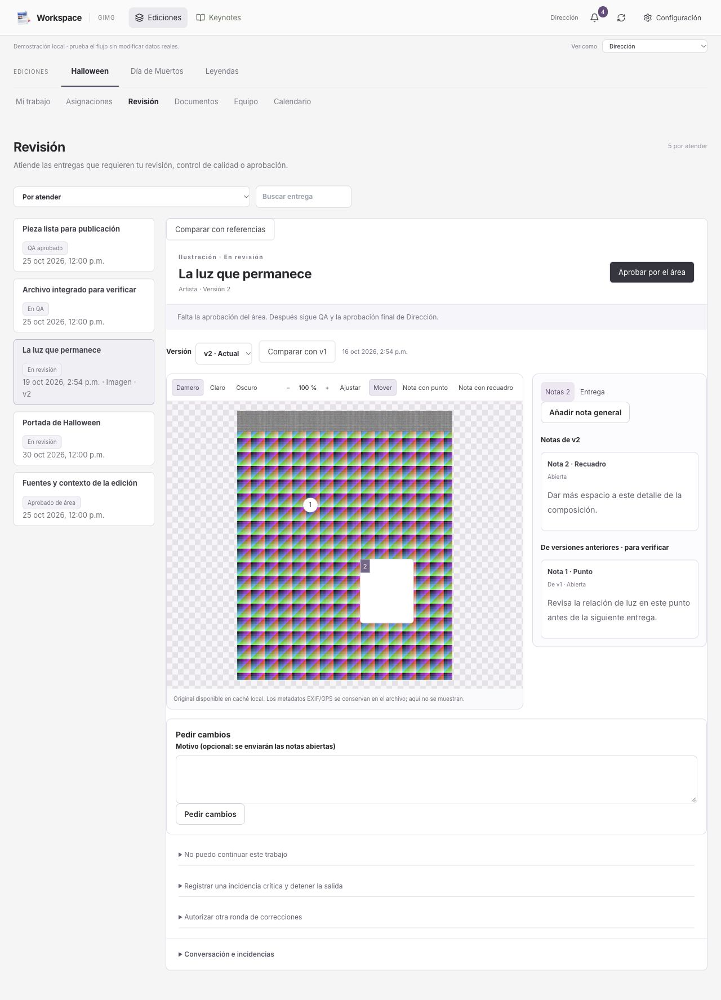

## Comparar con v1

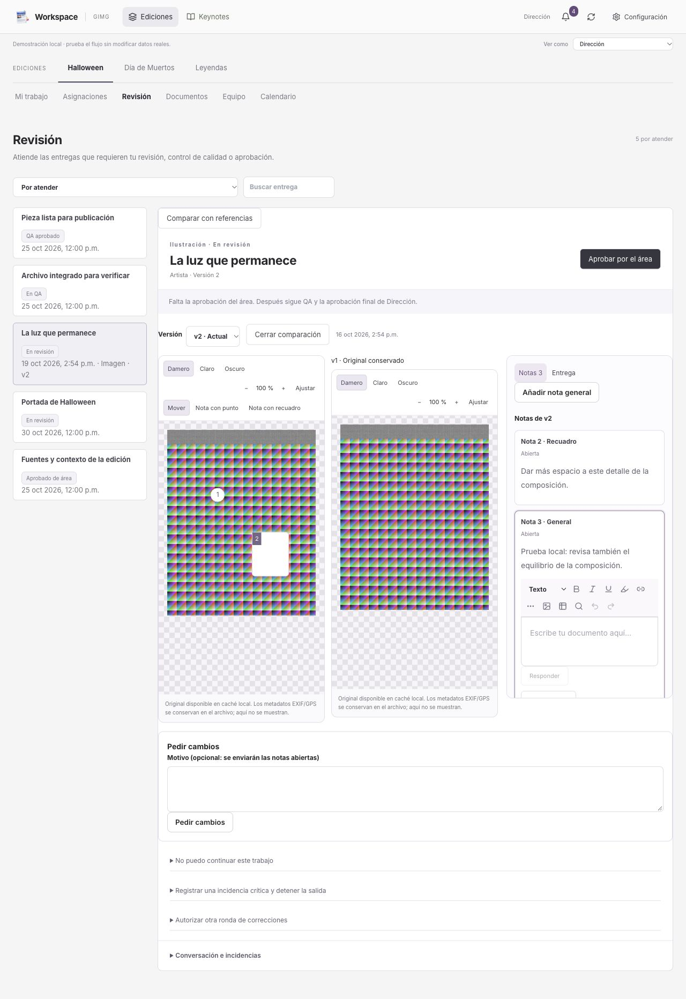

## PNG corrupto/truncado

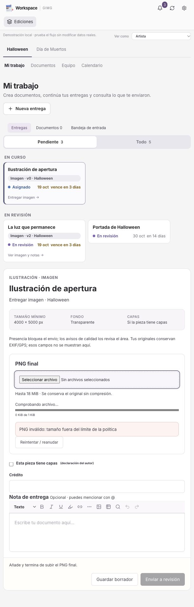

## Límite de política

## Formato no admitido

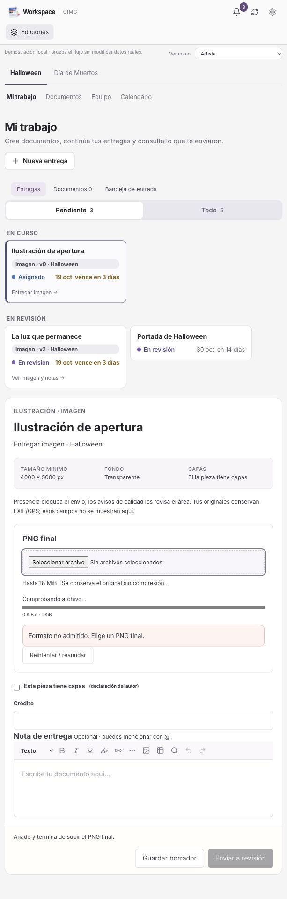

## Capas obligatorias

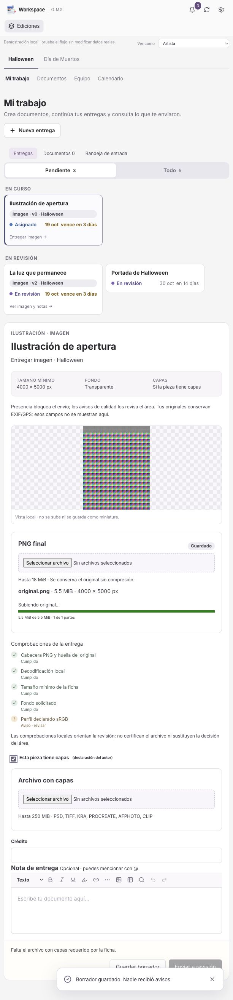

## Subida pausada/reanudable

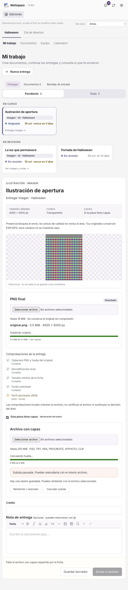

## Cuota sin espacio

## Sesión caducada

## Sin conexión

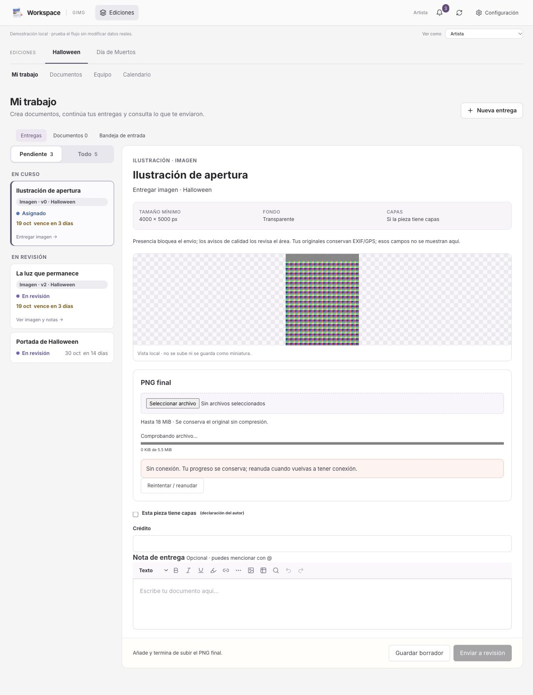

## Fallo del almacenamiento

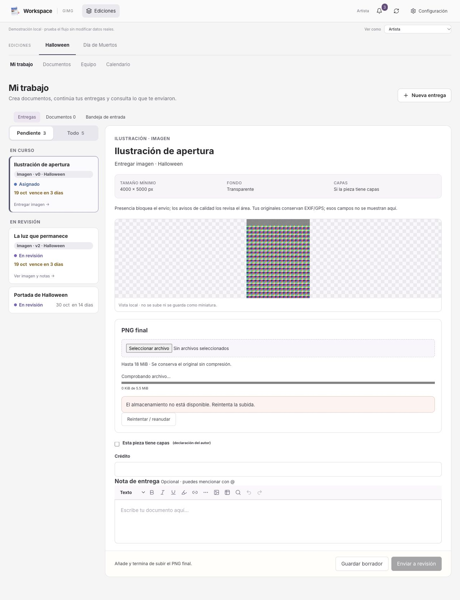

